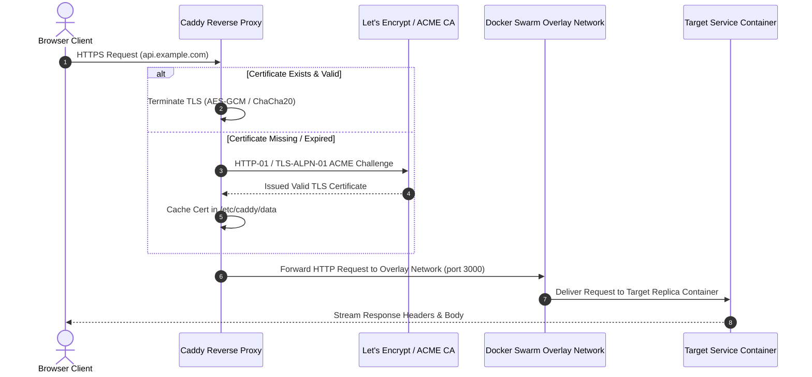
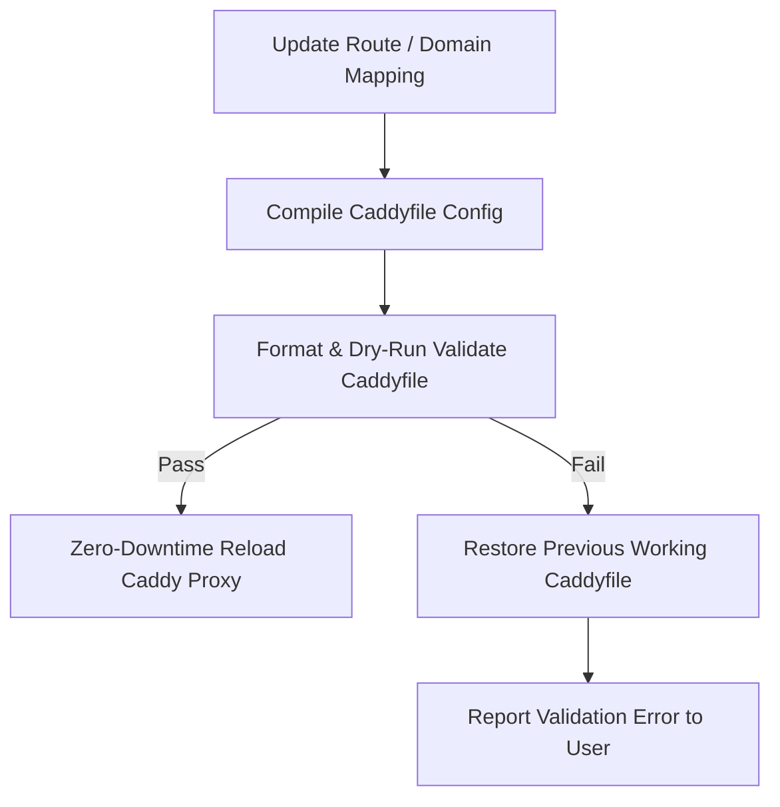

Upstand uses **Caddy** as the public `:80`/`:443` entry point and application
proxy. Caddy preserves domain mappings, middleware, certificates, and atomic
reload semantics while routing traffic to the configured application services.

---

## 1. Domain Configuration

You can assign public domains to Applications, Compose services, and Databases in the resource's **Domains** tab.

A domain mapping consists of:
- **Hostname**: A fully-qualified public domain name (e.g. `api.example.com`). Upstand normalizes hostnames and rejects raw IP addresses, wildcards, and ports.
- **Paths**: A public path prefix (e.g., `/v1`) and an optional internal rewrite destination.
- **Port Mapping**: The target container port (e.g., `3000`).
- **Snippets**: Reusable Caddy configuration snippets imported by name.
- **Path Stripping**: If enabled, strips the prefix before forwarding traffic.

---

## 2. HTTPS & SSL Strategies

Upstand configures and reloads certificates dynamically. You can choose between four certificate strategies:

### Let's Encrypt (Production Default)
- Automatically completes ACME HTTP-01 or TLS-ALPN-01 challenges.
- Optional ACME contact email for certificate expiration alerts and account registration.
- Caddy caches certificates, private keys, and renewal statuses in a persistent volume.
- **Prerequisites**: DNS must resolve to the Caddy host and TCP ports **80** and **443** must be open publicly.

### ZeroSSL
- Issues certificates via ZeroSSL ACME endpoints with ACME contact email registration.
- Useful when Let's Encrypt rate limits or policy restrictions apply.

### Caddy Internal CA (Self-Signed)
- Generates locally-trusted certificates using Caddy's built-in Certificate Authority.
- Best for staging, local development, or isolated private network deployments.
- *Note: Browsers and clients must manually import the Caddy root certificate to avoid untrusted warning screens.*

### Custom SSL Certificates
- Upload custom SSL certificates and matching private keys under **Infrastructure → Certificates**.
- Select the uploaded certificate directly on domain mappings or main web server domain configurations for enterprise or wildcard TLS management.

---

## 3. Security Headers & Redirects

Configure advanced proxy settings directly inside the domain mapping card:

- **Redirects**: Terminate incoming requests and issue HTTP `301/302/307/308` redirects.
- **Security Headers**: Inject standard headers to secure client connections:
  - `Strict-Transport-Security` (HSTS)
  - `X-Content-Type-Options: nosniff`
  - `X-Frame-Options: DENY`
  - `Referrer-Policy: no-referrer-when-downgrade`

---

## 4. Route Access Filters and Rate-Limiting Boundaries

Each domain mapping can block visitor IP addresses or CIDR ranges and
case-insensitive user-agent text. Routes can also enable hotlink protection to
reject requests whose `Referer` points to another hostname. Requests without a
`Referer` remain available for direct links. These filters use Caddy's built-in
`client_ip`, `header_regexp`, and header matchers and take effect when the
managed route configuration is applied. No extra edge service or proxy module
is needed.

Hotlink protection is a browser embed control, not authentication: clients can
omit or forge the `Referer` header. Use Basic Authentication or Forward Auth
when access must be restricted.

The IP filter uses the address Caddy resolves as the visitor. If traffic passes
through a trusted load balancer or CDN, configure trusted proxies in the Caddy
settings first; otherwise Caddy cannot safely distinguish the visitor from its
immediate peer. Review the active address ranges before saving to avoid
blocking your own access.

Operators can also define reusable Caddy snippets under **Web Server → Caddy
Snippets**. For example, this snippet allows requests only from the listed
network ranges and sets common response security headers:

```text
(office-network-only) {
    @outside_office not remote_ip 203.0.113.0/24 2001:db8::/32
    respond @outside_office "Forbidden" 403
    header {
        Strict-Transport-Security "max-age=31536000; includeSubDomains; preload"
        X-Content-Type-Options "nosniff"
        X-Frame-Options "DENY"
    }
}
```

- Replace the example CIDRs with the ranges you trust. `remote_ip` matches
  Caddy's immediate peer. If Caddy sits behind a trusted proxy, configure
  Caddy's trusted proxies before using the `client_ip` matcher for visitor IPs.
- Import a snippet on a domain mapping card by selecting it from the **Caddy
  Snippets** dropdown.
- The managed Caddy image uses Caddy's standard modules. The `rate_limit`
  directive comes from a third-party module and is not included, so a snippet
  using it fails Caddy validation. Apply rate limiting at an external CDN,
  load balancer, or API gateway. Country-based filtering is not currently
  available as a managed route control.

---

## 5. Authentication Middleware

Secure public routes before they hit your applications using Caddy-native authentication filters:

### Basic Authentication
- Prompt visitors for a username and password.
- Upstand accepts and persists **only Caddy-compatible password hashes** (e.g. bcrypt hashes). Plaintext passwords are never stored in the database.

### Forward Authentication
- Delegate access control to a central authentication gateway (e.g. `https://auth.example.com`).
- Caddy makes an out-of-band request to the authorization service prior to proxying.
- If verified, Caddy injects identity headers (such as `X-User-Id` or `X-User-Email`) into the upstream request.

---

## 5. Web Server Configuration Editor

The global Web Server settings page exposes a CodeMirror editor for:
1. **Global Caddy Settings**: Modify load balancing, timeouts, TLS settings, or logging parameters.
2. **Caddy Snippets**: Define named configuration blocks (e.g., rate limit configurations or IP blocks) that can be imported by resource domains.
3. **Configuration Previews**: Displays the compiled read-only Caddyfile for visual audit.

---

## 6. Dynamic SSL & Caddy Ingress Architecture



---

## 7. Atomic Validation & Reload Safety

To prevent web server downtime, Upstand validates all compiled Caddy configurations before applying them:



If Caddy rejects the formatted configuration, the reload is aborted, the previous working configuration remains active, and the operation is safely rolled back.
